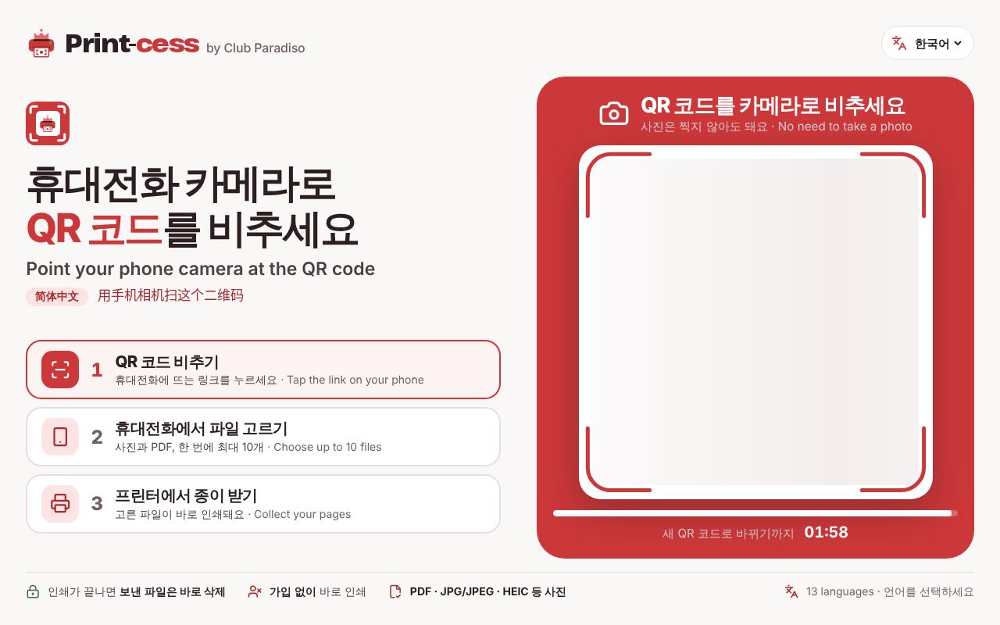
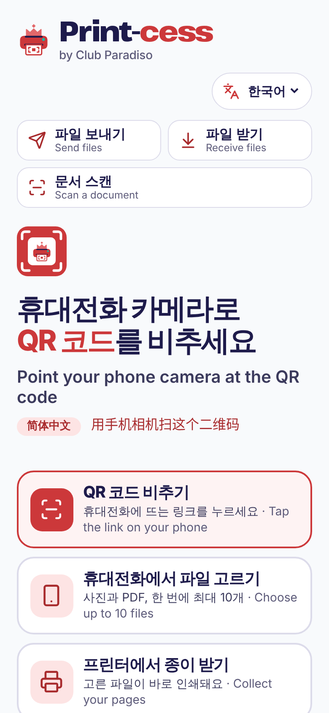
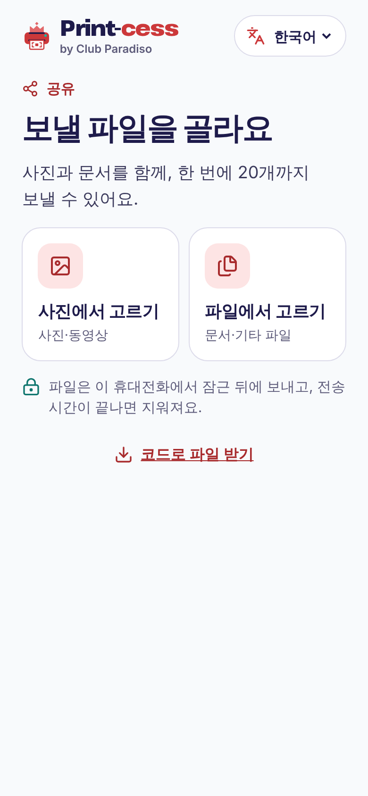
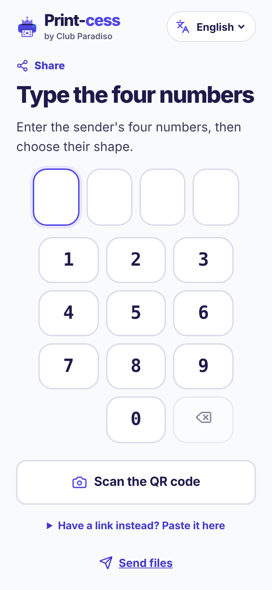

<p align="center">
  
</p>

<h1 align="center">Print-cess</h1>

<p align="center"><strong>by Club Paradiso</strong></p>

<p align="center">
  Print a document from your phone, or hand a file to another phone, without an account or an app.
</p>

<p align="center">
  <a href="README.ko.md">한국어</a> · <a href="LICENSE">Apache-2.0</a> ·
  <a href="SECURITY.md">Security</a>
</p>

---

Print-cess is for places like a government service counter, where someone needs one page printed
and has nothing but a phone. A visitor scans the QR code on the screen next to the printer, picks a
file, and gets one copy. There is nothing to sign up for or install, they never hand their phone to
staff, and the file is deleted once the job is done.

It does three things:

|           | What happens                                                 | Where it starts                            |
| --------- | ------------------------------------------------------------ | ------------------------------------------ |
| **Print** | A file on a phone becomes one printed copy.                  | The QR code on the kiosk screen (`/kiosk`) |
| **Share** | A file goes from one phone to another, end-to-end encrypted. | `/send` and `/receive`                     |
| **Scan**  | Paper becomes a PDF on the phone, ready to share or print.   | `/scan`                                    |

<p align="center">
  
</p>
<p align="center">
  
  
  
</p>

For counters, `/visitor` shows a QR code, the print progress and a countdown. A managed office PC
takes part through an ordinary browser, without installing software or working around endpoint
controls, and `/#environment` checks that browser.

## How it protects documents

- **Encrypted on the phone.** The file is encrypted before it leaves the device (P-256 ECDH,
  HKDF, AES-256-GCM). The server and its storage only ever hold ciphertext and cannot derive the
  key.
- **Keys stay out of the server.** QR codes and links carry their secrets in the URL fragment,
  which browsers never send to the server.
- **One document, one copy, then gone.** A print session accepts one upload and allows one print.
  Every ending, whether success, failure, cancellation, expiry or restart, leads to deletion.
  Phone-to-phone transfers expire after 30 minutes by default.
- **No accounts, no tracking.** There is no login and no analytics. File names never reach the
  server.
- **No policy bypass.** On managed computers it uses plain HTTPS and Web Crypto. It never tries to
  get around DLP, download controls, proxies or network separation.

There is one deliberate exception. The optional "four digits + shape" hand-off lets the server hold
a transfer key for three minutes so the sender can walk away. QR and link hand-offs never do this.
[`docs/FILE_TRANSFER.md`](docs/FILE_TRANSFER.md) explains the trade-off and its limits.

The full design is in [`docs/SECURITY.md`](docs/SECURITY.md),
[`docs/THREAT_MODEL.md`](docs/THREAT_MODEL.md) and [`docs/CRYPTOGRAPHY.md`](docs/CRYPTOGRAPHY.md).

## Status

Print-cess works end to end in development and on Preview deployments, but it is **not yet
approved for production use with real documents**. The remaining gates, including institutional
security and privacy review, provider approval, validation on the exact printer and a signed
installer, are listed in
[`docs/PRODUCTION_BLOCKERS.md`](docs/PRODUCTION_BLOCKERS.md).

Never use real personal documents in development, Preview, test fixtures or CI.

## Getting started

You need Node.js 24.18.0 and pnpm 11.15.1 (through Corepack). The Windows kiosk also needs the
.NET 8 SDK, and the end-to-end tests need Playwright's browsers.

```bash
corepack enable
pnpm install --frozen-lockfile
cp .env.example apps/web/.env.local
pnpm dev
```

Then open:

- <http://localhost:3000/kiosk> for the printer screen. Scan its QR code with a phone on the same
  network, or open the link it shows in another browser tab.
- <http://localhost:3000/send> and <http://localhost:3000/receive> to move a file between two tabs.
- <http://localhost:3000/> for the visitor's home, and <http://localhost:3000/#environment> for the
  managed-PC browser checks.

Local mode keeps everything on your machine and stores only ciphertext, in a development folder
inside the app. Hosted deployments refuse to start until real HTTPS origins and provider credentials are
configured. See [`docs/VERCEL_DEPLOYMENT.md`](docs/VERCEL_DEPLOYMENT.md).

## Repository layout

```text
apps/web             Next.js app: kiosk screen, phone flows, file hand-off, API routes
apps/kiosk           .NET 8 WPF kiosk for Windows: decryption, validation, printing
apps/cleanup-worker  Worker that sweeps expired files when QStash is not used
packages/            Protocol, cryptography, translations (13 languages), UI, test fixtures
docs/                Architecture, security, privacy, deployment and operations
```

## Checks

```bash
pnpm format:check
pnpm lint
pnpm typecheck
pnpm test
pnpm test:integration
pnpm build
pnpm test:e2e
```

The Windows kiosk is built and tested in GitHub Actions. A green build does not prove a printer
works: run the physical printer test in
[`docs/WINDOWS_PRINTER_ACCEPTANCE.md`](docs/WINDOWS_PRINTER_ACCEPTANCE.md) before any real
deployment.

## Deploying

| Target                         | Guide                                                                        |
| ------------------------------ | ---------------------------------------------------------------------------- |
| Web app on Vercel              | [`docs/VERCEL_DEPLOYMENT.md`](docs/VERCEL_DEPLOYMENT.md)                     |
| Storage and cleanup on Railway | [`docs/RAILWAY_PROVIDERS.md`](docs/RAILWAY_PROVIDERS.md)                     |
| Browser kiosk on a Mac         | [`docs/MACOS_BROWSER_KIOSK.md`](docs/MACOS_BROWSER_KIOSK.md)                 |
| Windows kiosk                  | [`docs/WINDOWS_KIOSK_DEPLOYMENT.md`](docs/WINDOWS_KIOSK_DEPLOYMENT.md)       |
| A government office            | [`docs/government-deployment-guide.md`](docs/government-deployment-guide.md) |
| Day-to-day operation           | [`docs/OPERATIONS_RUNBOOK.md`](docs/OPERATIONS_RUNBOOK.md)                   |

## Contributing

Bug reports and pull requests are welcome; see [`CONTRIBUTING.md`](CONTRIBUTING.md) and the
[Code of Conduct](CODE_OF_CONDUCT.md). For anything larger than a small fix, please open an
issue first so we can agree on the approach. Pull requests go to `main`, should pass the checks
above, and must use made-up data only. [`docs/GITHUB_WORKFLOW.md`](docs/GITHUB_WORKFLOW.md)
describes the review and release process.

Please report security problems privately, as described in [`SECURITY.md`](SECURITY.md).

## License

Print-cess is licensed under the [Apache License 2.0](LICENSE). See [`NOTICE`](NOTICE) for
third-party notices.

The license covers the code, not the names. "Print-cess" and "Club Paradiso", and their logos, may
not be used to present a modified version as the official service.
