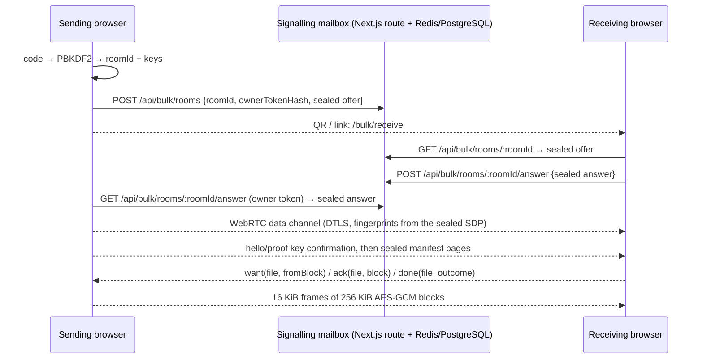

# Bulk Transfer 2.0 (direct, browser to browser)

Entry points: `/bulk/send` and `/bulk/receive` (also reachable from the ordinary `/send` screen and
from the ordinary `/receive` scanner, which forwards a bulk QR to the bulk receiver). Design
decision: `adr/0003-bulk-direct-transfer.md`. The v1 store-and-forward hand-off in
`FILE_TRANSFER.md` is unchanged and remains the consented fallback.

Status labels used throughout this document:

- **Implemented** — in the code on this branch.
- **Tested (automated)** — covered by unit, integration or browser E2E tests in this repository.
- **Not yet tested** — needs a physical device or a network this environment does not have.

---

## 1. Shape of a transfer

File bytes, file names, sizes and counts travel only on the data channel. The mailbox holds one
record per room: an opaque identifier, the owner-token hash, a generation counter, one sealed offer
and at most one sealed answer.

---

## 2. Protocol (v2)

All constants live in `packages/protocol/src/bulk.ts`; key derivation and sealing in
`packages/crypto/src/bulk-crypto.ts`. A v1 drop record cannot parse as a v2 room and vice versa.

| Item            | Value                                                                                            |
| --------------- | ------------------------------------------------------------------------------------------------ |
| Transfer code   | 12 Crockford base32 characters (60 bits), same alphabet and normalization as v1                  |
| Key stretching  | PBKDF2-SHA256, 310,000 iterations, salt `…:bulk-code:v2` (differs from v1, so ids never collide) |
| Derived         | 16-byte room id; HKDF → signal key, proof (HMAC) key, manifest key, one AES-GCM key per file     |
| Signal envelope | AES-256-GCM, random IV, AAD = domain ‖ room ‖ role ‖ generation                                  |
| Channel proof   | HMAC-SHA256 over room, role, generation, both nonces, both DTLS fingerprints                     |
| Manifest        | Pages of 150 files, each sealed with AAD = page ‖ pages ‖ fileCount                              |
| Content block   | 256 KiB plaintext → `iv(12) ‖ ciphertext ‖ tag(16)`; AAD = room ‖ file ‖ block ‖ blockCount      |
| Transport frame | `type ‖ file ‖ block ‖ fragment ‖ fragments ‖ payload`, ≤ 16 KiB or the negotiated maximum       |
| Limits          | 3,000 files, 64 GiB per file, 128 GiB per transfer, 180-byte UTF-8 names                         |
| Room lifetime   | 30 minutes sliding on owner activity, never beyond 12 hours from creation, 200 generations       |

### Why the IV is random

A resumed transfer re-reads and re-seals blocks. If the source file changed on disk between two
reads, a counter IV would encrypt two different plaintexts under one key and IV. A random 96-bit IV
per block costs 12 bytes in 256 KiB (wire overhead measured at 0.11 %) and removes that case.

### Control messages

`hello`, `proof`, `manifest`, `want`, `ack`, `done`, `window`, `pause`, `resume`, `finished`,
`cancel`, `unreadable` — each validated by a strict schema (`bulkControlSchema`). Anything else, or
any text message over 96 KiB, is refused unread and the channel is closed.

---

## 3. Transfer engine

`apps/web/src/lib/bulk/` — transport-agnostic behind `BulkChannel`, so the same code runs over a
real `RTCDataChannel` in the browser and over an in-memory pair in tests and benchmarks.

- **Receiver pulls.** It requests one file from a given block; the sender streams that file's
  blocks in order.
- **Ack after write.** The receiver acknowledges a block only after the destination accepted the
  write. A slow disk, a full batch or a paused screen therefore stops the sender instead of growing
  memory on the receiver.
- **Two bounds on the sender.** At most `window` unacknowledged blocks (receiver-advertised ceiling,
  default 16; additive increase on prompt acks, halved on stalls), and nothing queued above a 2 MiB
  `bufferedAmount` high-water mark (resumes at `bufferedamountlow`, 512 KiB).
- **Integrity.** Every block is authenticated; a block that fails authentication, arrives with a
  wrong fragment sequence or a wrong length is re-requested up to three times, then that one file
  fails with reason "damaged" and the rest continue.
- **Per-file outcomes.** `saved` (folder write closed), `stored` (held by this browser),
  `downloadStarted`, or `failed` with a reason (`damaged`, `unreadable`, `tooLarge`, `storage`).
  The sender shows only what the receiver reported.
- **Interruptions.** A closed channel, ICE `failed`, or eight seconds of ICE `disconnected` ends the
  attachment; 45 seconds without an acknowledgement also does. The sender opens the next generation,
  the receiver answers it, and the receiver asks for `want(currentFile, nextUnwrittenBlock)`. The
  interrupted file's destination stays open. Backoff between failed attempts is exponential up to
  eight seconds; after twelve consecutive failures the screen says so.
- **Pause, resume, cancel** from either side. Cancel waits for the send buffer to drain so the other
  device sees a cancellation, not a lost connection; the active file's partial output is deleted;
  completed files stay.
- **Memory.** Neither side reads a whole file. The sender holds one sealed block at a time plus at
  most the high-water mark in the channel buffer; the receiver holds one reassembly buffer
  (256 KiB + 28 B), at most `window` blocks of in-flight messages, and one byte of state per file.
- **3,000 files.** Manifest pages, one-byte state arrays, a linear name sanitizer
  (`uniqueSafeNames`: separators replaced, case-insensitive duplicates numbered), a Set-based
  selection dedupe on the sender, throttled progress events (≤ ~7/s), and a windowed list that keeps
  about fifteen rows in the DOM.

### What "resume" does and does not mean

| Situation                             | Behaviour                                                                                                                      |
| ------------------------------------- | ------------------------------------------------------------------------------------------------------------------------------ |
| Channel drops, both pages stay open   | Automatic reconnect in the same room; only missing blocks are sent (tested)                                                    |
| Receiving page reloads                | Not resumed. Files already saved to a folder remain; held batches are deleted                                                  |
| Sending page reloads                  | Not resumed. The browser no longer has the selected files; select them again                                                   |
| Phone locks or Safari is backgrounded | iOS may suspend the page; the transfer pauses and reconnects on return if the room is still alive (not yet tested on a device) |

Resuming across reloads would require persisting the transfer code or derived keys, which v1
deliberately refuses; this protocol keeps that position.

---

## 4. Receiving destinations

Chosen by feature detection only (`lib/bulk/staging.ts`); no user-agent branches.

| Destination                     | Where it is offered                                    | Outcome claimed   | Notes                                                                        |
| ------------------------------- | ------------------------------------------------------ | ----------------- | ---------------------------------------------------------------------------- |
| Folder (`showDirectoryPicker`)  | Desktop Chromium (Chrome, Edge)                        | `saved`           | Picked during the tap; every file written directly; duplicate names numbered |
| Batch in browser storage (OPFS) | Browsers where an OPFS `createWritable` probe succeeds | `stored`          | Budget = free quota − 512 MiB, capped at 4 GiB; transfer pauses when full    |
| Batch in memory                 | Browsers without writable OPFS                         | `stored`          | 256 MiB per batch, 512 MiB per file; larger files fail as "too large"        |
| Direct downloads                | Only when the transfer has ≤ 20 files                  | `downloadStarted` | One download per file, same path as v1                                       |

When a batch is full (or the transfer ends), the receiver shows the batch and offers it in groups of
20: **share sheet** (on iOS this includes "Save Images" / "Save to Files") or **download**. The
screen counts files "handed to Share or Download" and states that whether they reached Photos or
Files must be checked there — a page cannot observe that. Emptying the batch deletes it from browser
storage and the transfer continues. Leftover staging from a closed tab is deleted the next time the
page creates a batch.

`navigator.storage.estimate()` can promise more than the browser will actually let a page write.
The real-browser benchmark hit exactly that: writes began failing after about 915 MB although the
estimate allowed more. A write failure while a batch holds files is therefore treated as "batch
full": the partial file is discarded, put back at the front of the queue, the budget shrinks to what
is held, and the visitor is asked to save the batch. Only a write failure with an empty batch fails
the file (reason "storage").

Never claimed: that a file in browser storage is saved; that a started download finished; that a
share sheet put a file in Photos.

---

## 5. Security review

### Properties

| Property                             | How it holds                                                                                                                                 |
| ------------------------------------ | -------------------------------------------------------------------------------------------------------------------------------------------- |
| Server cannot read files or names    | Bytes and manifest travel only over the data channel; signals are sealed under a code-derived key                                            |
| Channel bound to the transfer secret | DTLS fingerprints sit inside authenticated envelopes; HMAC proof over both fingerprints and nonces                                           |
| No pairing without the code          | Room id is a PBKDF2 output; answers are authenticated by the sender before use                                                               |
| Replay resistance                    | AAD includes generation and role; the answer must echo the offer's fresh nonce; proofs include fresh nonces                                  |
| Integrity                            | AES-GCM per block with position-binding AAD; exact length check; final byte count check                                                      |
| No path traversal                    | Every received name passes `safeFileName` (separators replaced); duplicates numbered                                                         |
| Bounded allocation                   | Frame ≤ max message size; reassembly buffer fixed; control text ≤ 96 KiB; manifest ≤ 3,000 files, schema-validated; window ≤ 64              |
| Owner-only room control              | Polling, re-offering and deleting require the owner token (hashed at rest, constant-time compare)                                            |
| Rate limits                          | Per-address and per-room limits on every route; room creation charged to a shared hourly budget (`PRINT_CESS_BULK_HOURLY_ROOMS`, default 30) |
| No sensitive logging                 | Routes log nothing about SDP, candidates, codes, names; error bodies are generic                                                             |

### Threats considered

| Threat                       | Outcome                                                                                                                             |
| ---------------------------- | ----------------------------------------------------------------------------------------------------------------------------------- |
| Unauthorized pairing         | Requires the 60-bit code. A forged answer fails the sender's envelope check; the sender opens a new generation (tested)             |
| Mailbox or network tampering | Any change to a sealed signal fails AES-GCM; a substituted fingerprint fails the proof (tested)                                     |
| Session hijack after pairing | First answer per generation is final; a second device gets 409 and the screen says the code is taken                                |
| Replay of old offer/answer   | Generation and role in AAD; nonce echo (tested)                                                                                     |
| Malicious manifest           | Schema-validated, size-bounded, page-bound, re-sanitized names; a mismatching resend closes the channel (tested)                    |
| Oversized messages           | Rejected by frame decoder and control parser                                                                                        |
| Resource exhaustion          | Window, high-water mark, fixed reassembly buffer, per-file state of one byte                                                        |
| Corrupted chunks             | Re-requested, then the file fails alone (tested)                                                                                    |
| Interrupted transfer         | Resumes from the first unwritten block (tested in unit tests and in a real Chromium E2E)                                            |
| Code observed by a bystander | Same as v1: a person who sees the QR can connect first. The second device is refused; the sender sees the receiving device's counts |

### Differences from v1 that matter

- **Liveness instead of storage.** v1 lets the sender leave; v2 needs both pages open.
- **IP address exposure to the peer.** WebRTC necessarily lets each browser learn the other's
  network candidates (local addresses are obscured by mDNS in current Chromium and Safari). v1 never
  connects the two phones. On a shared or public network this is the trade for not storing files.
- **Public STUN.** By default each browser sends a STUN binding request to
  `stun:stun.l.google.com:19302`, which reveals its public address to that STUN operator. Set
  `PRINT_CESS_BULK_STUN_URLS=none` (host candidates only, same-network transfers) or point it at an
  approved STUN server if that is not acceptable.
- **The print-session model is untouched.** No print route, store or token kind changed; bulk
  rooms have their own store, token kind (`bulk`) and routes.

---

## 6. Browser compatibility matrix

"Tested" here means an automated test in this repository on the named engine. Rows marked
"not yet tested" are expectations from feature detection and must be confirmed on hardware.

| Capability                     | Desktop Chromium                                              | iOS / iPadOS Safari                                               | Android Chrome            |
| ------------------------------ | ------------------------------------------------------------- | ----------------------------------------------------------------- | ------------------------- |
| WebRTC data channel            | Tested (E2E, 2 contexts)                                      | Expected; not yet tested                                          | Expected; not yet tested  |
| Multi-select photos and videos | Tested (input `multiple`)                                     | Expected via Photos picker; selection-size ceiling not yet tested | Expected; not yet tested  |
| Folder destination             | Available (`showDirectoryPicker`); dialog not drivable in E2E | Not available                                                     | Not available             |
| Batch in OPFS                  | Tested (E2E)                                                  | Depends on writable OPFS probe; not yet tested                    | Expected; not yet tested  |
| Batch in memory                | Unit-tested logic                                             | Fallback if OPFS probe fails; not yet tested                      | —                         |
| Share sheet export             | —                                                             | Expected (`navigator.share({files})`); not yet tested             | Expected; not yet tested  |
| Download export                | Tested (E2E, bytes verified by SHA-256)                       | Expected; multi-download behaviour not yet tested                 | Expected                  |
| Screen wake lock               | Requested when available                                      | Requested when available; not yet tested                          | Requested when available  |
| Small-screen layout            | Tested at Pixel 7 viewport                                    | WebKit not installed in CI container — not yet tested             | Tested (Pixel 7 viewport) |

Observed in this environment: headless Chromium reports every non-ASCII blob download name as
`download` (reproduced with a bare anchor, independent of this feature). Korean names are displayed
correctly on screen and file contents verify; real-browser naming must be checked on devices.

---

## 7. Infrastructure and cost

Only existing infrastructure is used: the Next.js route handlers and the store already selected by
`PRINT_CESS_SESSION_PROVIDER`. No new provider, bucket, credential, or paid API.

Per direct transfer (request counts from the code paths; prices are the operator's to check):

| Step                          | HTTP requests                           | Store operations                                            |
| ----------------------------- | --------------------------------------- | ----------------------------------------------------------- |
| Capabilities (each side)      | 2                                       | 0                                                           |
| Create room                   | 1                                       | 1 budget + 1 create                                         |
| Sender waits for the receiver | 1 per second for 30 s, then 1 per 2.5 s | 1–2 per poll (read, keep-alive write at most once a minute) |
| Receiver reads the room       | 1 or a few                              | 1 per read                                                  |
| Answer                        | 1                                       | 1 read + 1 compare-and-set                                  |
| Keep-alive during transfer    | 1 per 5 minutes                         | 1–2                                                         |
| Reconnect                     | 1 offer + polls + 1 answer              | as above                                                    |
| Close                         | 1                                       | 1                                                           |

A receiver who scans within 20 seconds costs roughly 25–30 function invocations and a similar
number of Redis commands for the whole hand-off, whether it carries 20 files or 3,000. File bytes
cost nothing on the service side.

TURN, if enabled, relays every byte through the operator's relay and is billed by whoever runs it.
It is off by default and requires all three of `PRINT_CESS_BULK_TURN_URLS`,
`PRINT_CESS_BULK_TURN_USERNAME`, `PRINT_CESS_BULK_TURN_CREDENTIAL`. These static credentials are
published to browsers; use a relay that issues short-lived credentials before enabling it publicly.

### Cloud fallback

When a direct connection fails, the sending screen explains why (device-to-device traffic is often
blocked on office and school Wi-Fi) and, if the selection fits the v1 limits (20 files,
`DROP_MAX_TOTAL_MB`), offers the existing encrypted cloud hand-off. Opening the explanation does not
switch; the visitor must confirm a dialog that states the files are uploaded encrypted, unreadable
by the server, and deleted after 30 minutes. Only then does the v1 flow start (E2E verifies that no
`/api/drops` request is made before consent). Selections above the v1 limits are told to split.

**Cloudflare R2 was evaluated and not added.** Its pricing removes egress fees, which would halve
the bill for the download side of a cloud transfer, but a 3,000-file cloud transfer would still
store ~15 GiB per hand-off, add a credential to provision and rotate, and duplicate the S3-compatible
transport the repository already has (`railway-s3`, `S3BlobTransport`). If an operator later wants
R2 for v1 drops, that transport can point at an R2 endpoint as configuration, with its own quota
and expiry rules — no change to this feature.

---

## 8. Configuration

| Variable                          | Default                        | Meaning                                                   |
| --------------------------------- | ------------------------------ | --------------------------------------------------------- |
| `PRINT_CESS_BULK_STUN_URLS`       | `stun:stun.l.google.com:19302` | Comma-separated `stun:`/`stuns:` URLs; `none` disables    |
| `PRINT_CESS_BULK_TURN_URLS`       | unset                          | `turn:`/`turns:` URLs; requires username and credential   |
| `PRINT_CESS_BULK_TURN_USERNAME`   | unset                          |                                                           |
| `PRINT_CESS_BULK_TURN_CREDENTIAL` | unset                          |                                                           |
| `PRINT_CESS_BULK_HOURLY_ROOMS`    | `30`                           | Rooms one client address may open per hour (shared store) |
| `PRINT_CESS_BULK_CLOUD_FALLBACK`  | enabled                        | `false` hides the consented v1 fallback                   |

Expired rooms vanish on their own in Redis; on PostgreSQL the existing `/api/cleanup` sweep deletes
them (table `print_cess_bulk_room_v2`, created on first use).

---

## 9. Performance

`pnpm --filter @print-cess/web benchmark:bulk` (`BULK_BENCH=A,B,C,D`) runs the engine over an
in-memory channel pair with 16 KiB messages, synthetic content generated on demand and verified on
arrival. It measures framing, encryption, flow control, per-file overhead and memory. It does **not**
measure a radio, WebRTC's SCTP stack, a phone CPU, or phone storage; both endpoints share one Node
process, so throughput is a lower bound on engine capacity, not a network prediction.

See section 9.1 for the recorded run. Real-network and device measurements are on the checklist
below and are not yet available.

### 9.1 Recorded run

Environment: 4-vCPU Intel Xeon 2.1 GHz cloud container, Node 24.22.1, both endpoints in one
process, 16 KiB messages, 2026-11-15. Synthetic mix per workload: 1 % large videos holding 40 % of
the bytes, 0.5 % empty files, jittered photo sizes; Korean and duplicate names.

**Engine benchmark (automated, in-memory channel — not a network or device result):**

| Workload | Files | Data    | Time   | Throughput | ms / file | DC messages | Wire overhead | Peak send buffer | Live ArrayBuffers (peak, after GC) | Retained after | Peak RSS | Integrity                    |
| -------- | ----- | ------- | ------ | ---------- | --------- | ----------- | ------------- | ---------------- | ---------------------------------- | -------------- | -------- | ---------------------------- |
| A        | 20    | 100 MiB | 0.69 s | 145 MiB/s  | 34        | 7,258       | 0.111 %       | 256 KiB          | 0 MiB                              | 0 MiB          | 124 MiB  | 20/20 verified, 0 mismatches |
| B        | 300   | 1 GiB   | 6.5 s  | 158 MiB/s  | 22        | 74,433      | 0.112 %       | 256 KiB          | 18.6 MiB                           | 0 MiB          | 156 MiB  | 300/300, 0                   |
| C        | 1,000 | 5 GiB   | 30.3 s | 169 MiB/s  | 30        | 371,431     | 0.111 %       | 256 KiB          | 25 MiB                             | 0 MiB          | 171 MiB  | 1,000/1,000, 0               |
| D        | 3,000 | 15 GiB  | 89.5 s | 172 MiB/s  | 30        | 1,114,220   | 0.111 %       | 256 KiB          | 30.3 MiB                           | 0 MiB          | 186 MiB  | 3,000/3,000, 0               |

Worst event-loop lag stayed at 64 ms or less (D). Memory does not grow with workload size: the
retained ArrayBuffer and heap delta after the transfer and a forced collection was 0 MiB for every
workload, and the peak live figure varies run to run (sampling), not with bytes moved. CPU: about
13–14 user-CPU seconds per GiB for both endpoints together (encrypt, decrypt, framing, verification).

**Real-browser benchmark (automated, two Chromium 153 contexts on the same container, real
`RTCDataChannel` over loopback host candidates, receiving into the OPFS batch, `next dev`):**

| Workload | Files | Data    | Time        | Throughput      | Peak JS heap (sender / receiver) | Signalling requests (both pages) | Result                  |
| -------- | ----- | ------- | ----------- | --------------- | -------------------------------- | -------------------------------- | ----------------------- |
| A        | 20    | 100 MiB | 4.7–7.9 s   | 12.7–21.4 MiB/s | 17.5–19 / 18–21.7 MiB            | 11                               | 20/20 held in browser   |
| B        | 300   | 1 GiB   | 42.4–44.4 s | 23–24 MiB/s     | 28.5–29.4 / 28.3–30.6 MiB        | 11–12                            | 300/300 held in browser |

Frame size was compared before any tuning: 64 KiB messages gave 24.2 MiB/s against 23.6 MiB/s for
16 KiB on workload B, so 16 KiB stays (widest interoperability) and the message size is not this
setup's limit. The likely limits are the OPFS write path and both browsers sharing four vCPUs; that
is unconfirmed. Before pipelining writes the same setup measured 14.5 MiB/s on A.

One real-browser run of B exposed a defect, since fixed: OPFS writes failed after ~915 MB although
`storage.estimate()` allowed more, and the engine reported 44 files as failed. Such a failure now
pauses for the visitor as a full batch and retries the file (section 4; unit test "treats a quota
error mid-batch as a full batch"). The two B runs above are after the fix.

Workloads C and D were not run in the real browser here (the container's disk and time budget);
they ran through the engine benchmark above, and C/D in browsers are on the device checklist.

---

## 10. Physical-device acceptance checklist (not yet run)

Use synthetic files only. Record device, OS version, browser version, network, and results in
`docs/READINESS_EVIDENCE.md` format.

1. **iPad Air 4 (iPadOS Safari) → desktop Chrome, same Wi-Fi.** Select 300 mixed photos/videos from
   Photos in one picker action; confirm the count and size; transfer into a folder on desktop;
   verify count and a sample of SHA-256 digests. Record time and whether the iPad screen stayed on.
2. **Desktop Chrome → iPhone (iOS Safari), same Wi-Fi, 1,000 files / ~5 GiB.** Choose "이 브라우저에
   나눠 받기"; confirm the batch budget shown; at each pause, export through the share sheet with
   "Save Images" / "Save to Files"; confirm Photos/Files contain the batch; empty the batch; continue.
   Record peak Safari memory warnings, any tab reload, and total time.
3. **iPhone → iPad, LTE ↔ Wi-Fi.** Confirm whether a direct connection forms over STUN; record the
   indicator ("직접 연결됨" vs failure) and, on failure, that the fallback offer appears and does
   nothing until confirmed.
4. **Interruption.** During a 1 GiB transfer, toggle Wi-Fi off for 10 seconds on the receiver; the
   indicator must show "연결 끊김 · 다시 연결하는 중", then "직접 연결됨", and the transfer must
   finish without restarting completed files.
5. **Background and lock.** Lock the sending iPhone for 30 seconds mid-transfer; record whether the
   transfer pauses, resumes on unlock, or fails, and what the screen says.
6. **3,000 files / ~15 GiB, Android or desktop sender → desktop Chrome folder.** Record total time,
   any tab memory warnings, and verify the folder has exactly 3,000 files.
7. **Photo picker ceiling.** On iPhone and iPad, find the largest selection the Photos picker returns
   in one action; if under 3,000, confirm "더 고르기" appends further selections correctly.
8. **Storage pressure.** On a device with < 2 GiB free, choose batch mode and confirm the batch budget
   is reduced and that "too large" appears for a file that cannot fit.

---

## 11. Known limitations

- Both pages must stay open and in the foreground for the whole transfer; iOS may suspend a
  backgrounded or locked page (not yet measured).
- No resume across a page reload (by design; see section 3).
- STUN-only connectivity fails behind symmetric NAT on both sides or on networks blocking UDP between
  devices; TURN is optional and off.
- iOS Safari cannot write to a chosen folder; batches must be exported by the visitor, in taps of 20.
- The share sheet's behaviour with 20 large videos at once, and Safari's limit on downloads per tap,
  are not yet tested on devices.
- Translations: Korean and English are complete for this flow; the other eleven locales show English
  until their copy is reviewed.
- Desktop Chromium's folder dialog cannot be driven by Playwright; the folder path is covered by the
  shared `pickDirectoryTarget` logic and the existing `drop-save` tests, not by this feature's E2E.
